# Super Robot Wars Complete Box - English Translation v1.0

English translation patch for **Super Robot Taisen Complete Box** (PlayStation), covering **both discs**, in two font editions: **CAPS** and **Mixed Case**

**Download:** [SRWCB_English_v1.0.zip](SRWCB_English_v1.0.zip) (four xdelta patches plus readme.txt)

Requires your own original Japanese Disc 1 (SLPS-02070) and Disc 2 (SLPS-02071). No game files are included.

## Screenshots

| | | |
|---|---|---|
| 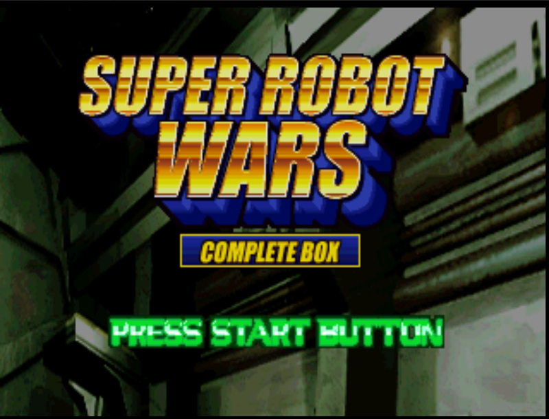<br>Disc 1 - Title Complete Box | 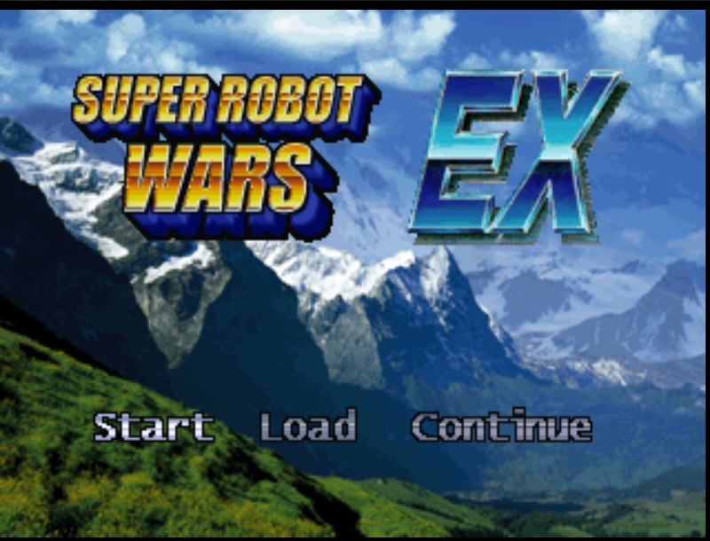<br>Disc 1 - EX Title | 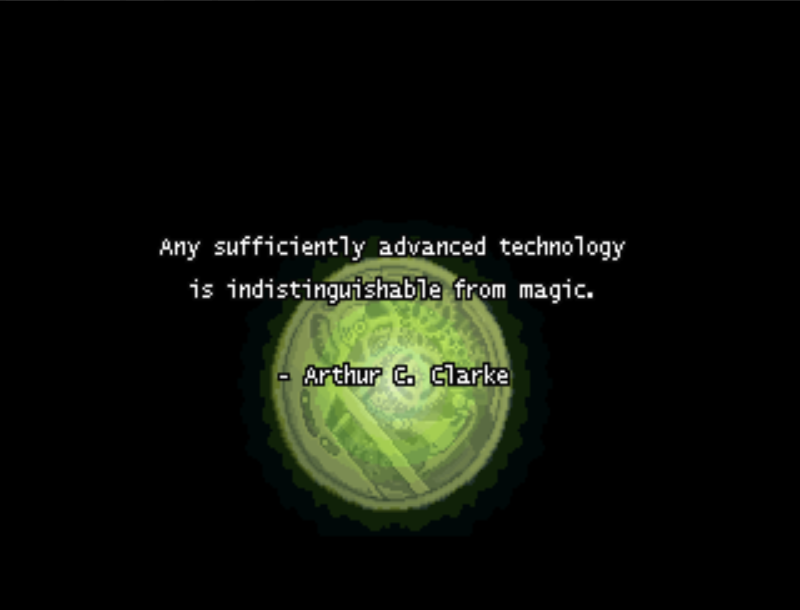<br>Disc 1 - EX Masaki Quote |
| 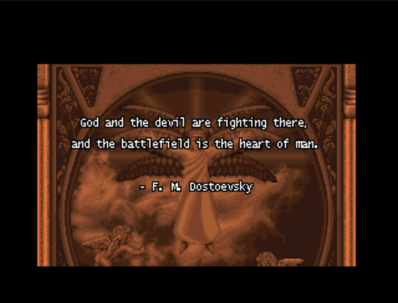<br>Disc 1 - EX Ryune Quote | 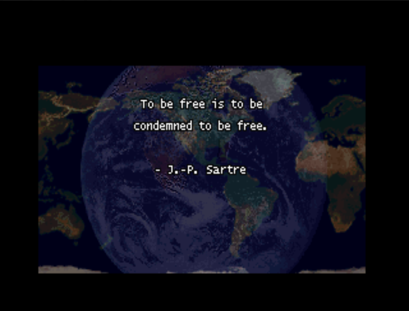<br>Disc 1 - EX Shu Quote | 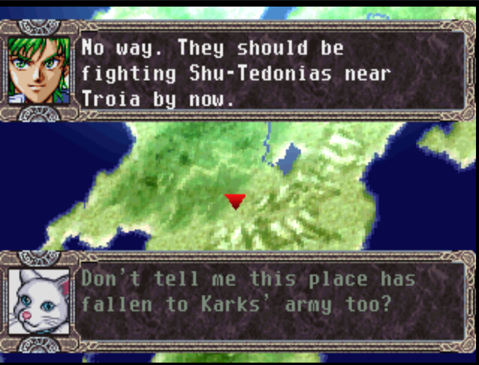<br>Disc 1 - EX Dialogue |
| 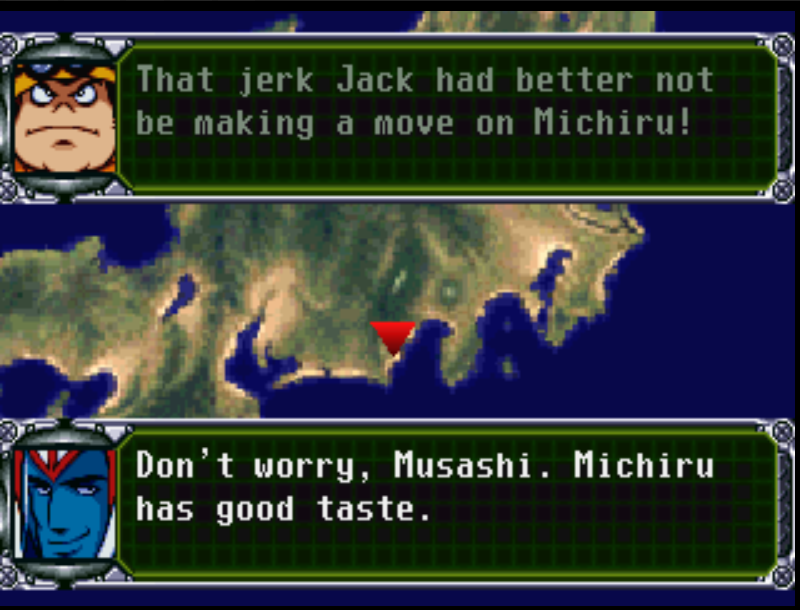<br>Disc 1 - 3rd Dialogue | 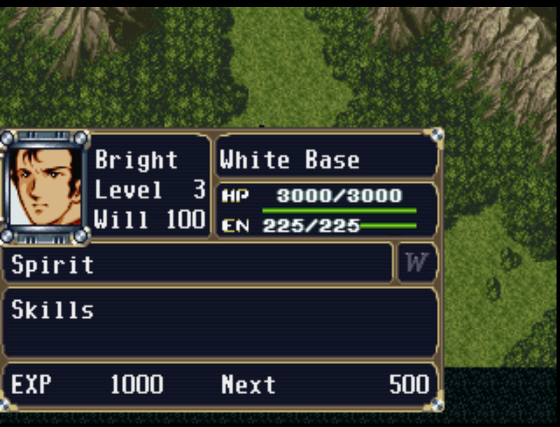<br>Disc 1 - 2nd Status | 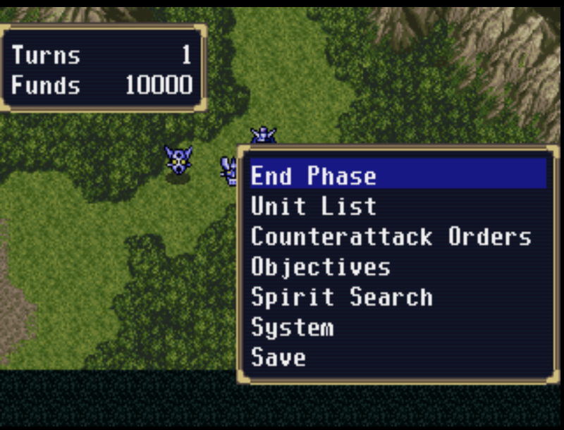<br>Disc 1 - 2nd Map Menu |
| 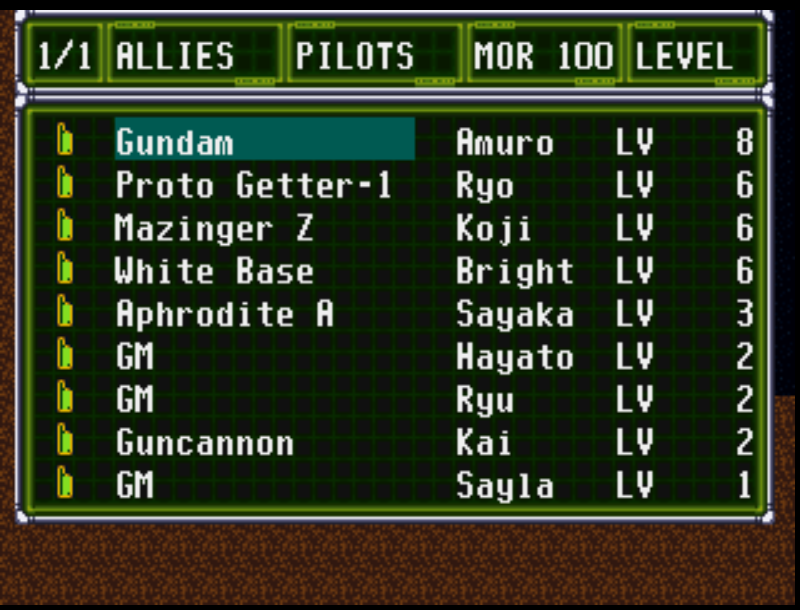<br>Disc 1 - 3rd Unit List | 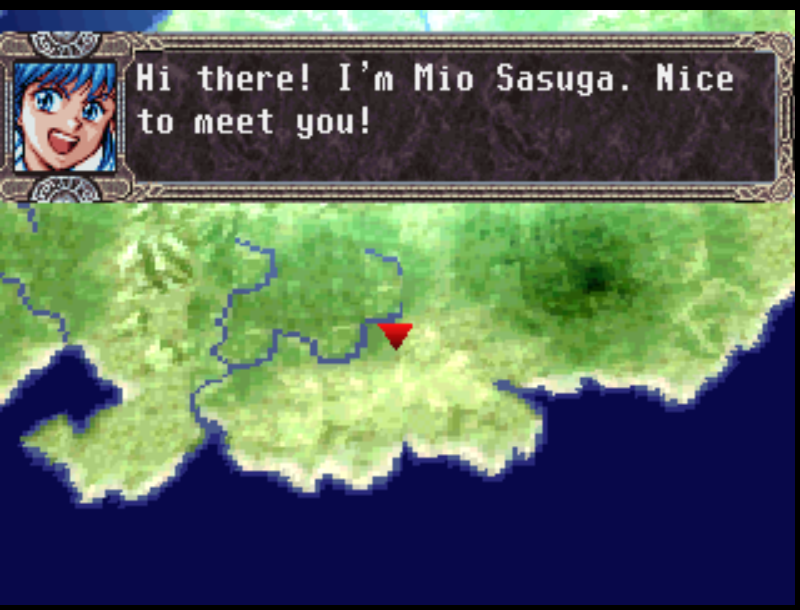<br>Disc 1 - Training | 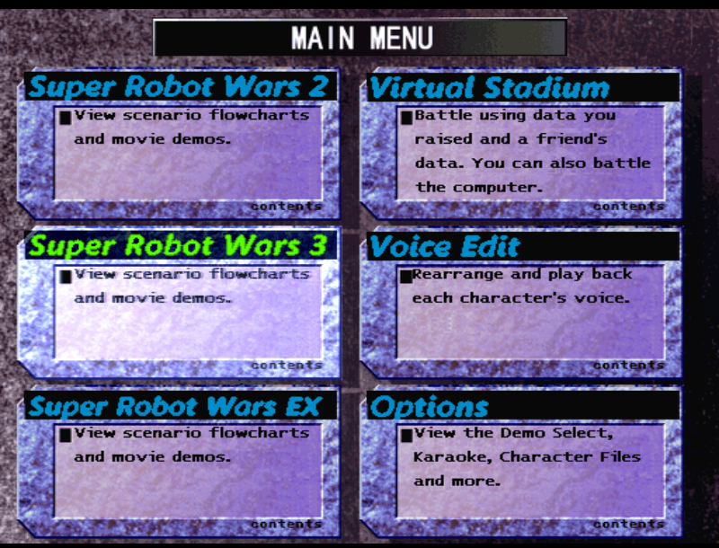<br>Disc 2 - Main Menu |
| 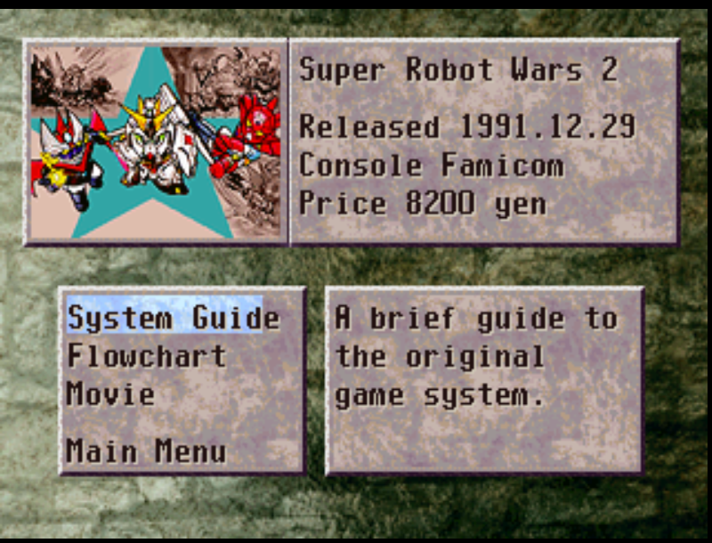<br>Disc 2 - History SRW 2 | 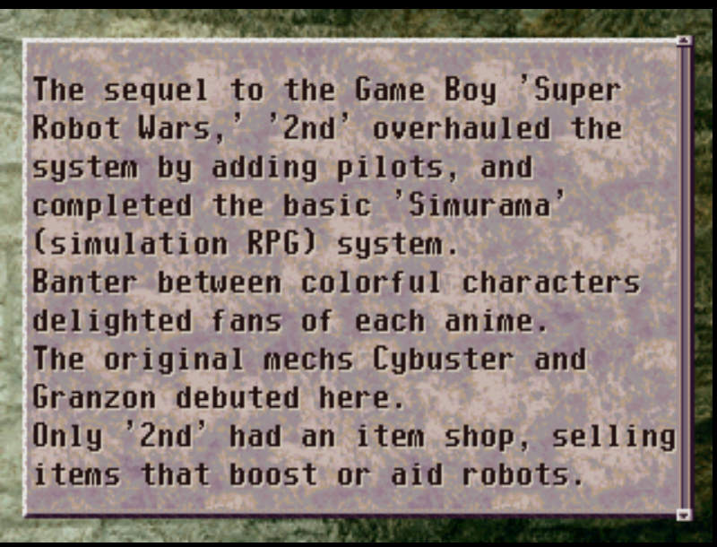<br>Disc 2 - System Guide | 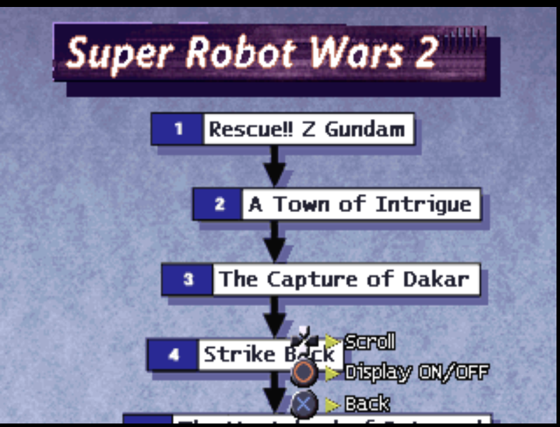<br>Disc 2 - Flowchart |
| 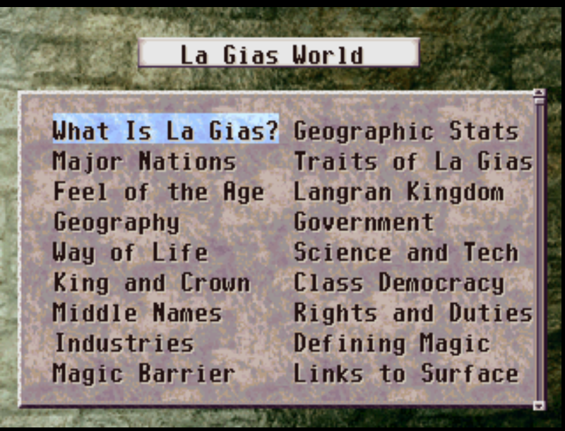<br>Disc 2 - La Gias World | 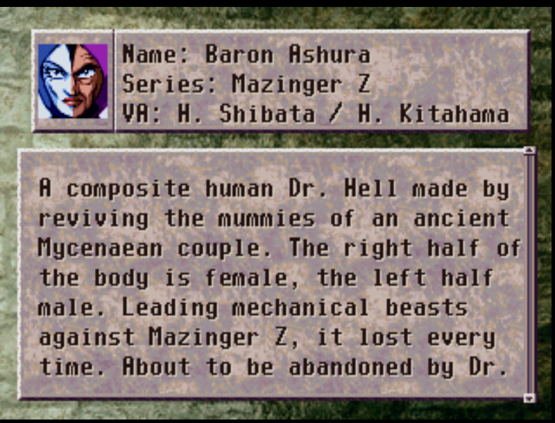<br>Disc 2 - Character Files | 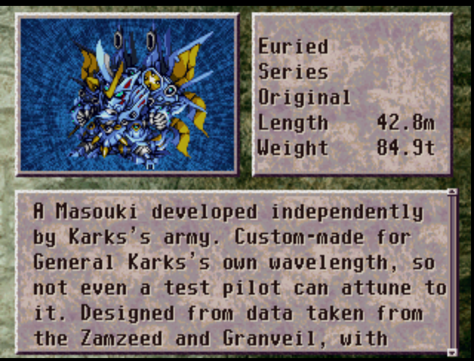<br>Disc 2 - Mech Files |
| 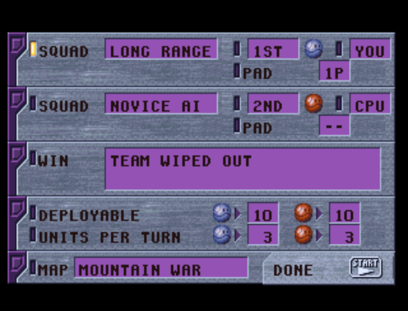<br>Disc 2 - Virtual Stadium (CAPS) | 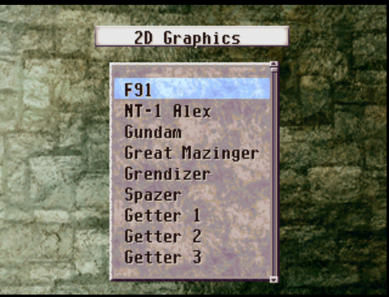<br>Disc 2 - 2D Gallery | 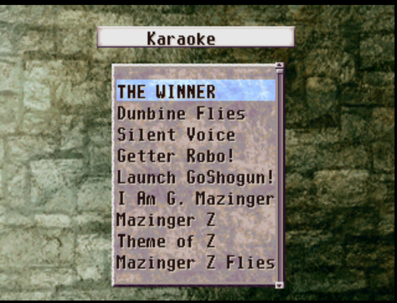<br>Disc 2 - Karaoke List |

## Readme

```
SUPER ROBOT WARS COMPLETE BOX
English Translation v1.0
By RetchERezzed

========================================================================

WHAT THIS IS
An English translation patch for Super Robot Taisen Complete Box on the
original PlayStation, covering both discs

ABOUT THIS TRANSLATION
Complete Box is possibly one of the toughest Super Robot Wars games to
translate, both in the amount of content and in the technical work needed
- Remakes of three Super Robot Wars games, 2, 3 and EX, combined together
- Five campaigns in total, counting the three EX chapters
- 150+ stages, many with branching paths, decisions and secrets
- A full second disc with extra content, videos, historical material and one
  of the only multiplayer modes in the series
- Two complete font editions, CAPS and Mixed Case, for both discs
- New English title screens, chapter cards, flowcharts and menus drawn to
  match the original artwork

Disc 1 holds four games in one
- The 2nd Super Robot Wars
- The 3rd Super Robot Wars
- Super Robot Wars EX, with the Masaki, Ryune and Shu chapters
- Training mode, an introduction to the game systems

Disc 2 is History of Super Robot Wars, a companion disc
- History pages for SRW 2, SRW 3 and EX with release info and system guides
- Scenario flowcharts showing every route and branch for all three games
- Character and robot encyclopedia with voice actor credits
- The Masoukishin world guide with essays on La Gias
- Virtual Stadium, a multiplayer mode where you battle your own units against a
  friend or the computer
- Voice Edit, to arrange and play back character voice lines
- Sound test, music player, karaoke and a demo and movie selection

========================================================================

CHOOSE A FONT
Two versions are included, pick the one you like
- CAPS: all-capital text, closest to the look of classic console games
- Mixed Case: upper and lower case text, easier to read in long scenes
Use the same font for both discs

WHAT YOU NEED
- Your own original Japanese Disc 1 and Disc 2, with their CUE files
- xdelta3, free from https://github.com/jmacd/xdelta/releases/tag/v3.2.0
- An emulator such as DuckStation, or real hardware
No game files, BIOS or emulator are included, only the patches

HOW TO PATCH (WINDOWS)
1) Make a backup of your original disc files
2) Put xdelta3.exe, your clean Disc 1 Track 1 BIN and the Disc 1 patch for your
   font in one folder
3) Open Command Prompt in that folder and run, for example
   xdelta3.exe -d -s "Disc 1 Track 1.bin" "SRWCB_English_v1.0_Disc1_MixedCase.xdelta" "SRWCB_Disc1_English.bin"
4) Do the same for Disc 2 with its own patch
   xdelta3.exe -d -s "Disc 2 Track 1.bin" "SRWCB_English_v1.0_Disc2_MixedCase.xdelta" "SRWCB_Disc2_English.bin"
5) Copy each disc's original CUE file and change only the first FILE line to the
   new BIN name, Disc 1 keeps its audio track line as it is
6) Open the Disc 1 CUE in your emulator and swap to Disc 2 when you want it
Tip: check your clean BIN with  certutil -hashfile "Disc 1 Track 1.bin" SHA256
and compare it to the checksums at the bottom of this file
Old save states will not work with the new patch, use normal memory card saves

========================================================================

WHAT IS TRANSLATED AND FIXED IN V1.0

Story and dialogue
- Every campaign fully translated: 2nd, 3rd and EX, plus Training
- About 2,900 lines retranslated from the Japanese with fuller, more natural wording
- Speaker names removed from lines where the portrait already shows who is talking
- Lines that had been cut short are restored to their complete meaning
- EX lines that showed a placeholder now show the real dialogue
- An EX scenario where lines appeared one line early is fixed
- Battle quotes and defeat lines translated for every character
- Consistent character and mecha names across all games, including Cybuster,
  Tytti, Prince Fayl, Ort, Quin Mantha, Akira Hibiki and Ballantine
- Valsion and Valsione kept as the two different machines they are
- Hundreds of smaller spelling, apostrophe and wording fixes

Title screens and graphics
- New English title logos for Complete Box, 2nd, 3rd and EX in the original
  gold chrome and blue 3D style
- English Start, Load and Continue on every title screen
- English copyright screens on both discs
- Chapter title cards redrawn in English for all three campaigns
- The EX opening quotes for Masaki, Ryune and Shu shown in full with their authors

Menus and systems
- All menus, help text, spirit commands and unit screens in English
- Terrain upgrade prompt, Yes/No choices and save messages translated
- Training chapter list and library lists translated
- System messages in sentence case for the Mixed Case version
- Unit Upgrade screen numbers, arrows and costs lined up cleanly in every game

Disc 2
- Main menu, history pages and help text in English
- All five scenario flowcharts in English with every chapter name
- Character and robot encyclopedia, voice actor lists and La Gias essays translated
- Virtual Stadium setup, options and battles in English
- Sound test and music titles in English
- Clean, readable menu headings in both fonts

========================================================================

KNOWN ISSUES
- Karaoke lyrics on Disc 2 remain in Japanese, the song titles are in English
- The gameplay demo movies on Disc 2 are recordings of the original Japanese
  games and still show Japanese
- The Japanese logo drawn into the end of the Disc 1 opening movie remains
- The Voice Edit name tabs on Disc 2 still show Japanese syllable groups
- A few small Disc 2 labels and the name entry keyboard remain in Japanese
- If you find anything else, please report it

REPORTING A PROBLEM
Please include the version, disc, game, chapter, font and emulator, plus a
screenshot if you can

========================================================================

CHECKSUMS

Clean Japanese Disc 1 Track 1 BIN
  Size     565543104 bytes
  CRC32    597AC371
  SHA-256  0ca4e5ee18ba4cbee65df6fab622cb988e3bb7d16fcb3fa2767e6640f1f92631

Patched CAPS Disc 1 Track 1 BIN
  Size     595392336 bytes
  CRC32    473A3AEE
  SHA-256  764e98f39c52931efa91966c16ce5b1e1b5d73903d6ff1212876974a3ae87193

SRWCB_English_v1.0_Disc1_CAPS.xdelta
  CRC32    C1A3C7EE
  SHA-256  5036646b3dfbc3ec16a32f7222cb52277ad889c1d1cfc40a3ff17def7f85ea07

Patched Mixed Case Disc 1 Track 1 BIN
  Size     601897968 bytes
  CRC32    374411B5
  SHA-256  b7b63cafa7dfab78a3920ee3a3095ef8a7939a9fd30336d51c596096df7db5db

SRWCB_English_v1.0_Disc1_MixedCase.xdelta
  CRC32    5AE44CF4
  SHA-256  20283a137133d20c9ecea9656699cc24aa143bf2524382b6098763ba0f3b1fba

Clean Japanese Disc 2 Track 1 BIN
  Size     642105408 bytes
  CRC32    BEF35311
  SHA-256  db3b2f901cf98df9a12bfa0771a6eb0b4e4207a9bacb43e020a4e5836d7e7640

Patched CAPS Disc 2 Track 1 BIN
  Size     645398208 bytes
  CRC32    4FBF70B1
  SHA-256  df5dc687e2ee2d3f28de711b3772bcdf106bb7794d098a38e4edcb186e7e3007

SRWCB_English_v1.0_Disc2_CAPS.xdelta
  CRC32    FC59F070
  SHA-256  04c977bba7cd1ec162b0d5964bc0657cc702c263d5bae7c002d2dae1276cb15d

Patched Mixed Case Disc 2 Track 1 BIN
  Size     644951328 bytes
  CRC32    C74CD533
  SHA-256  886392612a538a86d2c1749a638e8159b6c7687b395e327322c07248558051fe

SRWCB_English_v1.0_Disc2_MixedCase.xdelta
  CRC32    F25CBFA3
  SHA-256  e78e28f990bdaed847e803eedfc9b328f7384bee637bcb80a1edb4d79d1df466

========================================================================

Special Thanks to the RetroGameTalk community

Regards,
Retch
```
